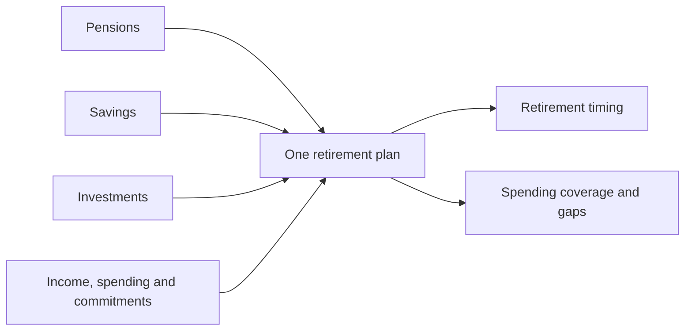

# Steadybee — landing-page design

11 October 2026 · Revised visual design for review

**Page purpose:** help a visitor understand that Steadybee is a retirement planning and tracking app, recognise a question they care about, and start exploring.

This designs the intended product. It does not change the running prototype. The page demonstrates three product moments: **your retirement picture → explore changes → track progress**. Alex and Jemma provide one clearly fictional household throughout the example.

## Page at a glance

```text
Steadybee                              How it works · Free and paid

When could you retire—
and what could you live on?

See your retirement picture. Explore what changes it.
Track your progress as life changes.

[ Start my free retirement plan ]       See Alex and Jemma's example
Free to start. No account connection needed.

One sourced research fact with its population and date beneath it

──────────────────────────────────────────────────────────────────

Pensions           Savings           Investments
    \                 |                  /
     └──────── One retirement plan ─────┘
            + Income, spending and commitments

──────────────────────────────────────────────────────────────────

[ Your retirement picture ] [ Explore changes ] [ Track progress ]

Alex and Jemma · Fictional example
Their situation → Their retirement picture → Their choices → Review

[ A retirement graph, result and selected control appear here. ]
[ This design supplies no invented financial figures or curves. ]

Shortcuts: Retire earlier · Income stops · Spend less · Market setback

Change a scenario → See the graph change → Understand the trade-off

──────────────────────────────────────────────────────────────────

Start free                      Go deeper when you need to
Your plan, basic scenarios      More detailed comparisons,
and manual updates.             investment and tax analysis,
                                and optional automatic updates.

──────────────────────────────────────────────────────────────────

Your next step starts with your retirement question.
[ Start my free retirement plan ]

Questions about accounts, examples and your information
Privacy · Terms · Contact
```

The wireframe shows hierarchy and placement. The graph region represents future app output, not a calculated result. The visible example opens in the page; no personal financial inputs are needed to try it.

## First screen

### Header

Steadybee wordmark on the left. Two quiet navigation links on the right: **How it works** and **Free and paid**. Both jump to their sections on this page.

Keep the header small and uncluttered so the retirement question leads.

### Hero — exact copy

# When could you retire—and what could you live on?

See your retirement picture. Explore what changes it. Track your progress as life changes.

**[ Start my free retirement plan ]**

See Alex and Jemma's example

Free to start. No account connection needed.

**Layout:** a large, left-aligned question with a short paragraph beneath. Remove the category eyebrow. Place the main button before the quieter example link, which scrolls to the fictional household walkthrough. Keep the supporting line immediately below the actions.

The question leads; one sourced research fact supports it below the hero. Do not add another competing question above the headline.

**Meaning of the supporting line:** connecting bank, investment or pension accounts is optional. It does not make a claim about signing in to save a plan.

## How it works

### A research fact supporting the question

**41% of adults aged 40–75 who weren't fully retired said they had no idea what income they would need in retirement.**

Immediately below: **Great Britain · DWP survey, 2024**, linked to the [Planning and Preparing for Later Life report](https://www.gov.uk/government/publications/planning-and-preparing-for-later-life-2024/planning-and-preparing-for-later-life-2024).

This concerns self-assessed retirement income needs, not awareness of planning apps. It is not a count of all UK adults. The relevant population is confirmed by Figure 5.2 and the survey questionnaire; retain the qualification beside the figure. The fact is a design hypothesis, not evidence that it improves conversion.

### Bring your money into one retirement picture

Use three clear, labelled line icons: **Pensions · Savings · Investments**. Connector lines bring them into **One retirement plan**. A quieter row adds **Income · Spending · Mortgage and family costs**.



The diagram describes the visual composition. Use consistent vector icons in the eventual page rather than emojis or bank logos. Keep labels visible; an icon cannot communicate account ownership or access restrictions by itself.

### Your retirement picture

Copy: **See when your plan covers your spending—and where it falls short.**

Show one retirement timeline, with separate spending needs and available income/resources. Mark each partner's retirement and pension access, major commitments and uncovered periods. An early gap must remain visible even if later income covers spending.

Lead with one calculated answer beside the graph. Allow a secondary view of savings, investments and pensions. Showing asset growth alone is insufficient when those assets are inaccessible at the time money is needed.

Keep three short details available: **Growth assumptions · Investment exposure · Funding gaps**. Growth is an explicit model assumption. Investment exposure and household spending shortfalls are different ideas; do not merge them into an unexplained risk score.

### Explore what changes it

Copy: **Change one thing. See what it means for retirement.**

Keep the same household and graph. Show the saved baseline and selected alternative together, distinguished by line style and labels. Place one active slider and its result beside the graph; do not open with a wall of controls.

Initial control: **Retirement date**. Other controls can select **Spending**, **Contributions** or a supported **Growth assumption**. Each displays its units, current setting, start date where relevant and a reset action. Keyboard and direct numeric/date entry work alongside dragging.

Shortcuts:

| Shortcut | What it changes |
| --- | --- |
| Retire earlier | Select an earlier work-end date using the same household finances. |
| Income stops | Specify whose earnings stop, the start date and duration. |
| Spend less | Select a declared spending reduction and when it begins. |
| Market setback | Apply a defined supported market scenario, with its assumptions visible. |

After a change, update the graph and a short explanation of spending coverage, gaps or retirement timing. Show increases and decreases where the calculation produces them; the interaction must not imply every change improves the plan. Explain fees, access and growth trade-offs where relevant.

Do not use a generic "risk" slider that only narrows a graph. If investment mixes are compared, show their declared exposure, growth and loss assumptions and household consequences.

### Track progress over time

Copy: **See what changed since your last review.**

Show the chosen plan's dated path alongside observed balances/contributions and the latest forecast. Past observations and future projections use distinct visual styles. Keep the original baseline visible when assumptions change.

The annual review includes:

- **Your choices:** options compared, then chosen or declined.
- **What happened:** changes actually completed, such as altered contributions or spending.
- **What else changed:** markets, earnings, withdrawals, inflation and assumptions where the data supports attribution.
- **What it means now:** the updated retirement and spending picture, including unresolved gaps.

An accepted suggestion is not a completed action. Choosing it changes the proposed plan; observed data or user confirmation establishes follow-through. Do not attribute market gains to the suggestion, or promise that the next year's graph moves upward. Clearly identify incomplete attribution.

## Alex and Jemma's walkthrough

Title: **See how Alex and Jemma explore their retirement.**

Label beside the title: **Fictional household example**.

Introduce their situation before any result: both work, have a mortgage and a child, and hold money across pensions, savings and investments. Their questions are when they could retire and what happens if one income stops. These are authored story facts, not a customer testimonial.

Use a visitor-controlled sequence in the same example panel:

| Slide | Story and visual |
| --- | --- |
| Their situation | Labelled household commitments and account icons. Explain the retirement question they want to answer. |
| Their retirement picture | The computed baseline, spending coverage, pension access and visible gaps across the full horizon. |
| Their choices | Try an income interruption, a spending change or another supported comparison. The same graph updates beside the control. |
| Their review | A dated follow-up distinguishes completed choices, actual observations and a revised forecast. Show what changed and why. |

Each slide has **Previous**, **Next** and a descriptive progress label. Visitors can choose a stage directly. Do not auto-advance. Keep the scenario reset and **Start my free retirement plan** available without forcing completion of the story.

Write the storyline and layout now. Capture the real app screens and author the numerical example after the relevant engine and interactions work. Every amount, curve, shortfall and comparison must come from a confirmed fictional baseline and reproducible calculation. This document intentionally does not invent those outputs.

Once built, use this same walkthrough on the landing page and in onboarding, rather than separately produced illustrations that show different behaviour from the app.

## Free and paid

Two simple blocks on desktop; stack free first on mobile.

| Start free | Go deeper when you need to |
| --- | --- |
| Build your retirement plan. | Compare more complex choices and combined scenarios. |
| Explore basic retirement and income-change scenarios. | Understand investment exposure and tax effects. |
| Update your figures yourself and see basic progress. | Understand changes against your saved plan. |
| Inspect the assumptions behind your results. | Add automatic updates from supported accounts. |

Copy beneath the comparison:

> You can enter your figures yourself. Account connections are optional, including when you use paid tools.

**Review note:** £5 per household per month is the current price hypothesis. Show the adopted price and exact included features here before offering a paid purchase. The hero stays focused on starting free.

## Final invitation

### Your next step starts with your retirement question.

**[ Start my free retirement plan ]**

This repeats the main action after the visitor has understood the offer.

## Short questions at the bottom

Use expandable answers; the question labels stay visible.

**Do I have to connect my accounts?**

No. You can enter your figures yourself. Connections are optional and available for supported accounts.

**Can I try it before entering my finances?**

Yes. Explore Alex and Jemma's clearly labelled fictional example to see how changing a scenario affects their retirement plan.

**Can I use it with my partner?**

You can build a household plan that includes each person's finances and work dates, alongside shared spending and commitments.

Footer links: **Privacy · Terms · Contact**. Describe data controls accurately on the linked pages and near information collection.

## What happens after a click

| Action | Destination and first experience |
| --- | --- |
| Start my free retirement plan | Open the planner with a short choice: planning for yourself or your household. Ask the retirement/work question, then progressively collect the figures needed to answer it. Keep unknown values distinct from zero. |
| See Alex and Jemma's example | Scroll to and activate the inline fictional household walkthrough. No personal inputs or sign-in are required. |
| Your retirement picture / Explore changes / Track progress | Select the corresponding example stage while preserving the household context. |
| Scenario shortcut | Select the corresponding supported comparison, reveal what it changes and allow editing before applying it. |

The example panel shows one question, its calculated answer and a retirement timeline. A scenario control sits beside the consequence it changes. Inputs, assumptions and workings remain inspectable. The statistic about retirement income needs is external research, not a calculated result for Alex and Jemma.

Let visitors begin entering their plan before asking them to create an account. Explain sign-in requirements when they choose to save across devices. Starting a plan must not silently save sensitive information or connect accounts.

**Current prototype:** use **Start my draft** while personal forecasts are not implemented. Offer only example controls whose results are actually calculated. The full personal-plan wording belongs to the intended release described in the [vision](VISION_DRAFT.md).

## Visual treatment and mobile layout

- Deep blue/teal headings and primary action, with a restrained honey accent and a calm, light background. Verify contrast for every actual colour pair.
- One readable humanist sans-serif font. Body text at least 18px, comfortable line spacing and generous margins.
- One visually dominant action per section. The example link has lower emphasis; it remains easy to find.
- Controls at least 44px in their smallest dimension, visible keyboard focus and descriptive accessible names.
- Flat, quiet sections with subtle separation. Keep the scenario choices and pricing blocks simple.
- On mobile: header → hero → actions → supporting line → qualified research fact → account diagram → household introduction → example stages → free/paid → final invitation → short questions → footer.
- Stack actions and plan comparisons. Keep story slides visitor-controlled, with visible navigation rather than a swipe-only carousel.
- Keep the headline readable without a chart. The graph appears in the example panel, with a readable result and text alternative.
- Use accessible stage selectors, clearly labelled slider controls and an announced result update after a change settles. Respect reduced-motion preferences; any graph transition is brief and never loops.

## Review checks

The first screen should make **retirement**, **scenario exploration** and **progress tracking** clear. The icon diagram establishes household finances. The first click should match the expectation created by its label. Verify that people understand the example is fictional, notice funding gaps, and can distinguish their choices from observed investment performance.

Review this alongside the [copy proposal](LANDING_PAGE_DRAFT.md) and [design system](DESIGN_SYSTEM.md). No website implementation, price adoption or conversion claim is implied by this document.
